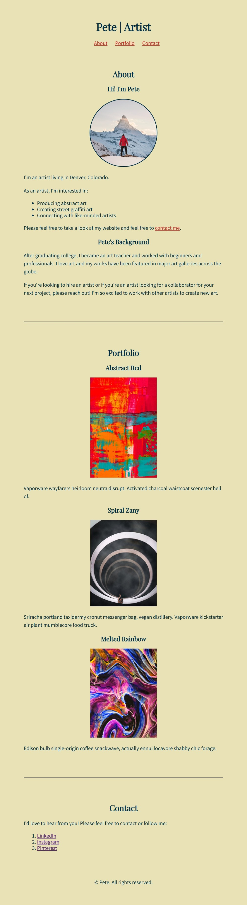
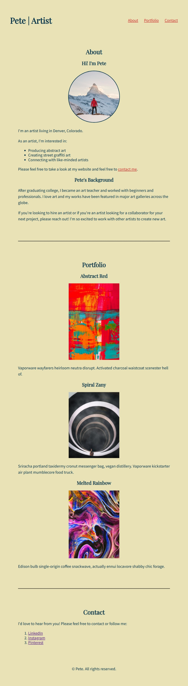
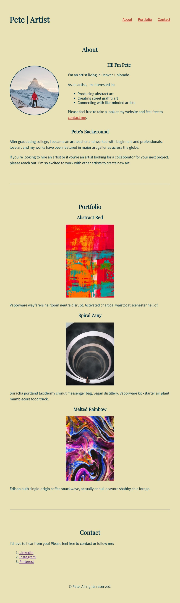
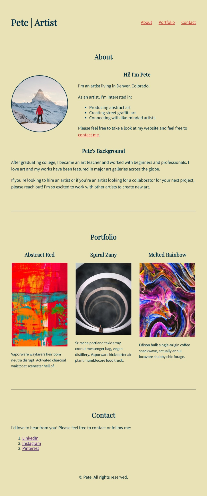
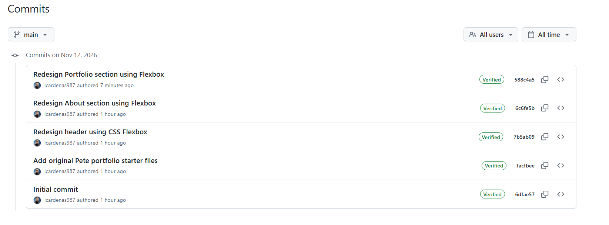

# Pete's Portfolio Redesign

## Project Description

This project is a redesign of Pete's artist portfolio website. The website introduces Pete, showcases his artwork, and provides contact information.

## Original Website Design

The original portfolio contained a Header, About section, Portfolio section, Contact section, and Footer.

Before the redesign:

- Pete's name and navigation links were stacked vertically.
- Pete's profile image appeared above his introduction.
- The portfolio projects were displayed vertically.
- The main content was contained within a narrow column.

### Original Layout

## Revised Design and Mockup

The redesign focuses on three major layout improvements:

1. A horizontal header with Pete's name and navigation links on the same row.
2. An About section with the image and introduction side by side.
3. A Portfolio section with three projects displayed horizontally.

### Header Redesign

I used CSS Flexbox to display Pete's name on the left and the navigation links on the right.

The main CSS properties were:

- `display: flex` to create a horizontal layout.
- `justify-content: space-between` to separate the title and navigation.
- `align-items: center` to vertically align the elements.
- `max-width: 1100px` to control the header width.

### About Section Redesign

I reorganized the About section using separate HTML containers for Pete's image and introduction.

The `about-image` container holds Pete's round picture, while `about-text` holds the introduction, interests, and contact link.

I used CSS Flexbox to arrange the containers horizontally. The introduction heading is centered within the text area, while the paragraphs remain left-aligned.

Pete's Background appears underneath the image and introduction.

### Portfolio Section Redesign

I added a `portfolio-section` container to organize Pete's three projects:

- Abstract Red
- Spiral Zany
- Melted Rainbow

Using CSS Flexbox, I displayed all three projects in a horizontal row with spacing between them.

The artwork headings are centered, and the project descriptions use the required `14px` font size.

### Contact Section

The Contact section appears underneath the Portfolio section.

It contains Pete's original contact message and links labeled LinkedIn, Instagram, and Pinterest.

## Design Choices and Trade-offs

### Color Scheme

I kept the same colors because the light background and dark text provide contrast while allowing the artwork to stand out.

### Layout and Alignment

I selected CSS Flexbox because it provides a straightforward way to position elements horizontally and control spacing.

I also widened the main content container to provide more room for the redesigned About and Portfolio sections.

### Design Trade-offs

I chose to retain the original colors instead of creating an entirely different visual theme.

## Implementation Plan

1. Create a GitHub repository.
2. Add the original Pete Portfolio starter files.
3. Preview the original website and capture a screenshot.
4. Redesign the Header using CSS Flexbox.
5. Modify the About section's HTML and CSS.
6. Redesign the Portfolio section using Flexbox.
7. Check the complete website and navigation.
8. Capture screenshots of the development milestones.
9. Prepare the README documentation.
10. Publish the website using GitHub Pages.

## Challenges, Debugging, and Learning

### Header Alignment

The original header displayed Pete's name above the navigation links.

I used Flexbox to arrange the elements horizontally and vertically center them.

### About Section Structure

The original About section placed the image above the introduction.

I reorganized the HTML into separate image and text containers and used Flexbox to position them side by side.

### CSS Container Widths

Some original CSS rules applied fixed widths to containers.

I used more specific CSS selectors and adjusted the container widths to support the new layout.

### Portfolio Layout

The original Portfolio section displayed the artwork projects vertically.

I added a parent container and applied Flexbox to display the three projects horizontally with spacing between them.

### Learning Outcomes

This project helped me practice:

- HTML structure and organization
- CSS Flexbox
- CSS selectors and specificity
- Horizontal and vertical alignment
- Container widths and spacing
- Browser testing
- Git commits and version control
- Markdown documentation

## AI Tools Disclosure

I used ChatGPT to help understand CSS Flexbox and with the README documentation.

GitHub Codespaces was used as the development environment, and GitHub was used for version control.

## Screenshots and Development Evidence

The following screenshots document the development process.

### 1. Original Website

### 2. Header Redesign

### 3. About Section Redesign

### 4. Portfolio Section Redesign

### 5. Final Completed Website

### 6. Git Commit History

**Development environment note:** The development screenshots were captured using GitHub Codespaces and the web browser rather than Replit.

## Git Commit History

The project uses Git commits to document the redesign process.

Development milestones include:

1. Initial repository creation.
2. Adding the original starter files.
3. Redesigning the Header using CSS Flexbox.
4. Redesigning the About section.
5. Redesigning the Portfolio section.
6. Adding documentation and screenshots.

The actual Git commit records can be viewed here:

[View GitHub Commit History](https://github.com/lcardenas987/Pete-Portfolio-CSS/commits/main/)

## Final Website

The completed website includes:

- A horizontally aligned Header.
- An About section with the image and introduction side by side.
- Three artwork projects displayed horizontally.
- Portfolio descriptions using a 14px font size.
- A Contact section.
- Consistent colors and typography.
- Centered desktop content.

## Project Links

**GitHub Repository:**

[https://github.com/lcardenas987/Pete-Portfolio-CSS](https://github.com/lcardenas987/Pete-Portfolio-CSS)

**GitHub Pages Website:**
https://lcardenas987.github.io/Pete-Portfolio-CSS/

## Conclusion

This project provided practical experience with HTML, CSS Flexbox, GitHub, and web development documentation.